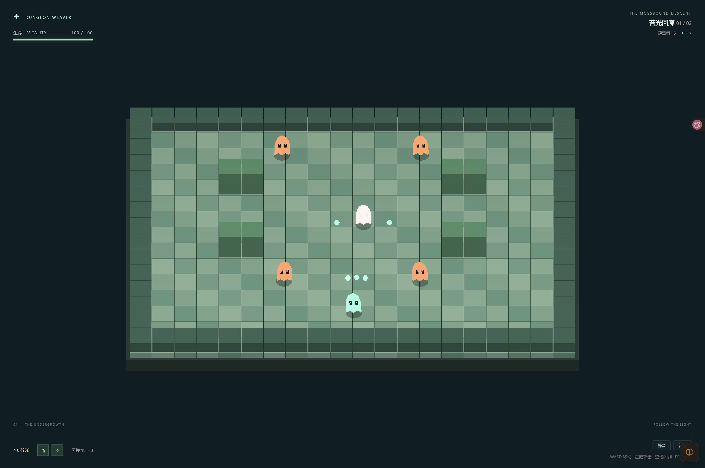

# Dungeon Weaver · 苔光地牢

浏览器地牢动作肉鸽原型：两间战斗房、灵弹射击、闪避、三选一奖励与通关结算。使用原创程序化角色和场景。

**Bun 1.3.14 + Vite + TypeScript strict + Three.js + postprocessing + React + Tailwind CSS + Jotai。** 游戏微内核为独立的纯 TypeScript，可在 Bun 中运行真实战斗与测试。



## 运行

```sh
bun install --frozen-lockfile
bun run dev
```

打开 http://localhost:4173 。WASD 移动，鼠标瞄准，按住左键射击，空格闪避，Esc 暂停。当前操作面向桌面键鼠。

```sh
bun test
bun run check:data
bun run sim --seed=42
bun run build
bun run preview
```

生产预览地址为 http://localhost:4174 ，构建产物在 `dist/`。

## 已有能力

- 60Hz 固定步进、种子随机数、SoA TypedArray 对象池、二维空间网格与墙体碰撞。
- 2 间战斗房、1 间测试庭院；5 种祝福：分裂射击、弹墙、吸血、冲刺强化、伤害强化。
- Three.js 实例化 Billboard、4 帧精灵图集、倾斜、轻微挤压、受击闪白、顿帧、Bloom。
- ZzFX 缓存音效与 AudioContext 压缩器，支持静音。
- Jotai `createStore()` 与 React Provider 共用实例，仅推送变化的 HUD 数据。
- 开发环境 `window.__DEBUG__` 支持构造场景、精确步进、结构化状态与截图。
- Bun 无头测试和 Tabbit 浏览器测试调用同一套真实规则。

对象池容量为 2000 个敌人、5000 发投射物；这些数字是容量配置。同屏性能、GC 和不同设备的帧率仍需专门测量。

## 文档

- [架构与开发范围](docs/design.md)
- [依赖与调研来源](docs/research.md)
- [调试接口与 Tabbit 会话复用](docs/debugging.md)
- [实际验证记录](docs/verification.md)

后续内容包括房间路线生成、更多武器与敌人、Boss、近战判定、冲刺残影及树木遮挡透视。当前原型用于验证战斗与自动化开发链路。

## 许可

原创代码、文档和程序化美术采用 [MIT License](LICENSE)。第三方依赖保留各自许可与署名。
