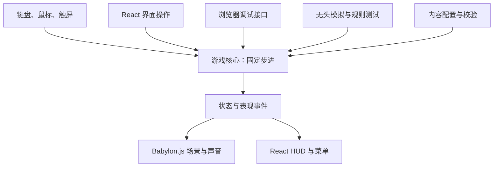

# 游戏与技术方案

## 目标与范围

制作一个可直接在浏览器游玩的地牢动作肉鸽。玩法借鉴房间探索、主动射击与闪避、道具联动和祝福构筑，角色、场景及故事使用原创内容或可再分发素材。

第一个完整可玩目标：1 个角色、3 种基础武器、12 个道具或祝福、8 个房间模板、4 类普通敌人、1 个 Boss。每局经过约 6～8 个房间，目标时长 10～15 分钟。数量是内容范围，时长和难度需要试玩调整。

基础操作采用 WASD 移动、鼠标瞄准、攻击与闪避；触屏输入通过同一份输入结构接入。界面提供暂停、音量、奖励选择和结算。

## 现成技术的职责

| 部分 | 采用的技术 | 项目自己的内容 |
| --- | --- | --- |
| 项目与类型检查 | 官方 Babylon.js 脚手架、Vite、TypeScript strict | 入口和模块组合 |
| 界面 | React + CSS | HUD、商店、背包、奖励卡片 |
| 场景与表现 | Babylon.js | 摄像机、美术、动画映射、特效配置 |
| 实体管理 | Miniplex | 玩家、敌人、投射物和效果组件 |
| 碰撞 | Rapier 2D | 命中对象、攻击形状、阵营、闪避规则 |
| 地牢与随机数 | rot.js | 房间模板、路线约束、奖励与刷怪配置 |
| 数据约束 | Zod | 字段边界、资源引用、组合合法性 |
| 声音 | ZzFX、Babylon.js 音频能力 | 音色参数和音效触发 |
| 验证 | Vitest、Playwright、Tabbit | 真实规则测试、试玩流程与截图场景 |

复用依据和限制见[调研文档](research.md)。

## 三个代码职责

| 位置 | 职责与依赖 |
| --- | --- |
| `src/game/` | TypeScript 游戏状态、输入、动作、战斗和房间规则。允许使用 Miniplex、Rapier 2D、rot.js；可以在 Node.js 中运行。 |
| `src/content/` | 武器、敌人、祝福、房间和效果参数，以及 Zod 校验。 |
| `src/view/` 与 `src/ui/` | Babylon.js 场景和 React UI，读取核心数据、显示结果、提交玩家操作。 |

这些路径是实现时的组织约定。需要某项功能时才建立对应模块，一个行为保留一个实现入口。

核心持有位置、生命值、攻击阶段、冷却与道具状态。场景对象属于表现层，核心无需访问 DOM、Canvas 或 Babylon.js Mesh。React 订阅生命值、奖励和菜单等展示状态；实体逐帧位置留在游戏更新循环中。

Miniplex 用于管理普通对象和组件查询。移动、攻击、碰撞和结算仍然是有明确调用顺序的普通函数。只在已经出现重复行为时提取共用逻辑。

## 时间与可重现性

基础 tick 固定为每秒 60 次。自动游玩、`step(N)` 和无头模拟共用同一更新入口。显示刷新率可以不同，核心的步长保持一致。

前摇、判定、后摇、无敌帧和冷却用模拟 tick 表示。实际等待时间只用于驱动自动循环与记录性能，玩法计时不依赖 `setTimeout`。

地图、战斗和视觉效果使用分开的随机状态，复用 rot.js 的 RNG。测试记录种子、场景和输入序列；相同条件应得到可重复结果。

顿帧与慢动作使用统一时间控制：基础 tick 始终计数，顿帧期间消耗剩余顿帧 tick，战斗更新冻结；慢动作通过累计缩放时间推进战斗。状态同时暴露基础 tick、战斗 tick、时间缩放和顿帧剩余值，便于解释测试结果。

## 地面、碰撞与动作

游戏空间的 X-Z 是地面，Y 表示视觉高度。Rapier 2D 的两个坐标映射到 X-Z。角色采用运动学控制，攻击判定、阵营及伤害结算由游戏规则管理。

高速投射物需要覆盖前后位置之间的运动路径，使用现成的形状投射或适合的连续碰撞能力；验收薄墙、墙角、移动目标和高速冲刺。不同攻击使用圆、矩形、扇形或扫掠范围，并明确可命中目标及一次攻击的命中次数。

动作状态包含 idle、move、windup、active、recovery、dash、stagger、dead。每种攻击配置前摇、有效判定和后摇 tick。动作取消、击退、中断和无敌的优先级通过具体规则测试验证。

## 道具与祝福组合

普通数值变化写在配置中；需要新行为的道具使用小型效果函数。效果接入以下事件：

- `onFire`：射击数量、散射角、发射间隔。
- `onProjectileSpawn`：穿透次数、弹射次数、追踪能力。
- `onHit`：伤害、状态、击退、吸血及衍生效果。
- `onKill`：掉落、击杀奖励和后续触发。
- `onDash`：冲刺附加效果与后续攻击强化。

事件顺序和修饰器顺序固定。衍生攻击带来源标识、触发深度及命中过的目标记录，配置有限触发次数；同一次命中按规则只结算一次。

目标组合示例：火球命中分裂，分裂弹可弹墙，暴击留下火池；闪避后的首发攻击获得暴击强化。验证组合时同时检查伤害、衍生数量、触发次数和对象回收。

## 房间与路线

房间使用可读的二维数组或字符串行配置。符号表示墙、地面、掩体、刷怪点、门与出生点；JSON 由标准解析器读取，字段由 Zod 校验。

每个房间记录入口方向、出口方向、可通行网格、敌人预算、奖励类型。复用 rot.js 的地图及寻路能力，附加游戏自己的路线规则：起点可以到达 Boss，奖励点可达，门的两侧可通行，出生点位于安全地面。

房间类型包括战斗、宝箱、商店、事件和 Boss。房间模板保证局部战斗空间可用，程序负责选择、连接和配置。

## 表现与性能

采用正交或固定俯视摄像机，角色可以使用低多边形模型或朝向摄像机的精灵图集。画面表达攻击预警、有效攻击区域和闪避状态。

打击反馈参数包括顿帧、受击闪白、镜头震动、冲刺残影、击退、受击硬直和击杀慢动作。闪屏和震动提供减弱选项。手感通过真实试玩、连续录制及可重放输入评估。

同材质的重复对象优先使用引擎实例化、精灵批处理或粒子系统；对象销毁频繁时复用对象。不同表现采用适合的绘制方式，批次数、透明排序、GPU 时间及内存以实际测量为准。

性能报告记录设备、浏览器、场景、敌人和投射物数量、帧时间分布及峰值内存。目标是常见桌面环境流畅游玩；同屏容量与无头模拟速度需要实测后填写。

## 从可玩的内容开始验证

| 顺序 | 可用结果 | 验证方式 |
| --- | --- | --- |
| 单房间战斗 | 玩家能移动、攻击、闪避，一类敌人可被击败 | 同时接入状态查询和步进；核心规则测试加浏览器实际操作 |
| 一条完整路线 | 清房、选奖励、换房、挑战 Boss、结算 | 固定种子通关与死亡路径，无头模拟及浏览器流程 |
| 扩展组合 | 增加武器、祝福、房间和敌人 | 配置检查、真实组合测试、截图及性能测量 |

调试能力随第一间可玩房间一起实现。每次增加玩法，都提供直接到达对应场景的方式。

本方案吸收了用户提供参考材料中的结构化状态、无头验证、固定步进、内容配置和打击反馈要求。外部文章中的开发规模与性能数字不作为本项目的实测结果。
