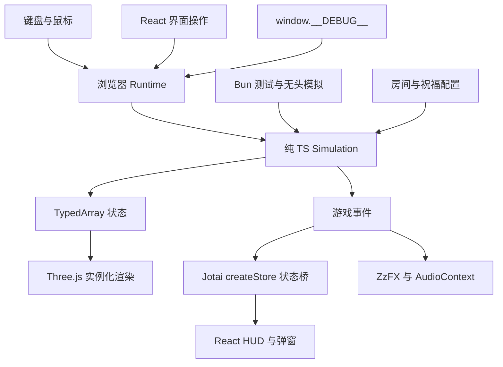

# 架构与开发范围

## 技术分工

| 层 | 技术与职责 | 实现位置 |
| --- | --- | --- |
| 工具链 | Bun 1.3.14 包管理、测试、无头模拟；Vite 开发和构建；TypeScript strict | package.json |
| 微内核 | 60Hz Simulation.tick()、种子随机数、SoA 对象池、二维网格、碰撞、动作与效果结算 | src/engine/ |
| 内容 | ASCII 字符串房间、祝福定义与 Hook | src/content/ |
| 表现 | Three.js、postprocessing、Billboard 实例化与 GLSL | src/view/renderer.ts |
| 音效 | ZzFX 生成缓存，AudioContext 播放、限流与动态压缩 | src/view/audio.ts |
| UI | React、Tailwind CSS、Jotai Vanilla Store | src/ui/ |
| 连接与调试 | 浏览器输入、时间累计、事件投递、开发调试入口 | src/runtime.ts、src/debug.ts |

微内核只实现这个游戏需要的行为。代码规模随真实功能增长，不按行数限制模块或省略测试。

## 高频与低频状态

位置、速度、生命、投射物寿命、受击闪白等核心字段存放在对象池中。渲染直接读取数组。每个池用连续活动槽位和空闲槽位管理实体，回收槽位后分配新的实体 ID。

`createUiBridge()` 创建一个 store，交给 React Provider 和 Runtime。Runtime 收到扣血、击杀、祝福、换房等事件后，按字段检查并更新 Atom。移动和渲染不写 Atom。暂停弹窗由浏览器操作维护，调试暂停可以保留完整战斗画面。

核心对局独立于 React、Jotai、Three.js 和 DOM。通过外部事件适配器连接 UI，使每个无头对局可以拥有独立状态。`computedStatsAtom` 与战斗共用 `calcPlayerStats()`，属性公式只维护一份。

## 时间、随机数与碰撞

基础 tick 固定为 1/60 秒。Runtime 用真实时间累计驱动 tick；调试和 Bun 直接调用相同入口。隐藏页面或失去焦点时暂停，恢复时清空真实时间累计，避免补跑后台停留时间。

`tickCount` 记录基础步数；`combatTick` 仅在实际战斗更新时增加。顿帧消耗基础 tick，冻结战斗更新。射击冷却、冲刺、无敌和投射物寿命采用战斗 tick。渲染动画读取战斗时间，截图时不会自行漂移。

`SeededRNG` 使用 Park–Miller 算法，当前控制敌人速度。固定种子、内容和输入用于重放；跨运行时一致性通过实际场景逐字段比较。视觉与音效不能消耗游戏随机状态。

二维网格使用有限房间的整数格坐标直接索引数组。敌人坐标建立空间索引，投射物查询附近实体。投射物按最多 0.1 单位的子步推进，墙体和圆形命中逐步检查；增加速度、改变体积或加入移动攻击时需要补充相应测试。角色使用分轴墙体碰撞，敌人使用房间距离场寻路。

容量不足时敌人创建给出明确错误；弹幕记录 `rejectedBullets`。应根据实际场景测量容量、帧时间、分配与内存。对象池不会自动保证整个程序零 GC。

## Hook 与房间

`onFire` 修改发射数量和伤害，`onSpawnBullet` 配置反弹次数与每次反弹倍率，`onDash` 配置轨迹和下一枪强化，`onKill` 处理近距离击杀奖励。效果按内容定义顺序执行，每项祝福最多一层。新增行为直接加入内容模块并验证与已有祝福的组合。

房间配置使用 `#` 墙、`.` 地面、`P` 出生点、`C` 冲锋兽、`T` 投弹怪、`G` 卫兵、`B` Boss。`check:data` 汇总行宽、高度、符号、出生点、地面可达性和祝福 ID 错误。六间房按顺序连接，共 46 个敌人；五间普通房有 2～3 波，末房为 Boss。清波后留出 1.5 秒调整位置，清房恢复 12 点生命并选奖励。奖励列表由同一函数提供给 UI、核心校验和 Bot；所有祝福已拥有时提供继续入口。

敌人动作直接使用接近、前摇、攻击、恢复四种状态。冲锋和挥击在前摇时锁定朝向；投弹在开始前摇时锁定落点；卫兵恢复阶段放下盾牌。Boss 按冲撞、落弹、扇形弹幕顺序出招，半血后恢复时间从 65 tick 缩短至 28 tick，弹速从 6 提高到 8。未引入通用行为树或技能编辑器。

普通弹伤害 18，攻击间隔 12 tick。蓄力需 12～60 tick，移动速度从 4.8 降至 2.5；松开后伤害为 18 × (1 + 4 × 蓄力比例)。蓄力弹记录已命中的实体 ID，最多贯穿 8 个不同目标，反弹后也不会重复命中同一目标。冲刺取消正在进行的蓄力，必须松开再按才能重新蓄力。

反弹最多两次，伤害倍率在反弹时结算。破晓仅消费一次攻击事件，可同时强化该次攻击的散射弹。烬行轨迹共享每个敌人 15 tick 的受伤间隔，重叠轨迹不会在同一 tick 重复伤害。轨迹、落弹和视觉事件是短生命周期数组，按战斗 tick 到期回收；当前不承诺整个战斗零分配。

## 表现与后续内容

当前有 45° 俯视相机、五类原创四帧 Billboard、实例化地面和投射物、移动摆动、蓄力挤压和光圈、武器后坐力、受击闪白、击退、冲刺余影、消散、顿帧、轻微震屏及 Bloom。冲撞方向、卫兵挥击范围、Boss 扇形攻击和落弹位置由核心状态直接驱动。Boss 血量按命中事件更新 Jotai，蓄力光圈与冲刺恢复条直接由 Three.js 渲染。

片元着色器处理非有限颜色并限制输出范围；仍需检查 CPU 输入、材质编译和渲染目标，不能据此承诺所有黑屏都已预防。场景使用程序化美术，音效为 ZzFX 合成；精细动作素材、随机路线、更多武器、敌人分离及树木遮挡透视属于后续内容。

当前内容为 1 个角色、1 把支持连射和蓄力的武器、6 个祝福、6 间流程房与 1 间训练场、3 类普通敌人及 1 个 Boss。5～8 分钟是人工试玩目标，尚未验证；Bot 的模拟通关时间不能代表人的学习与选择时间。
