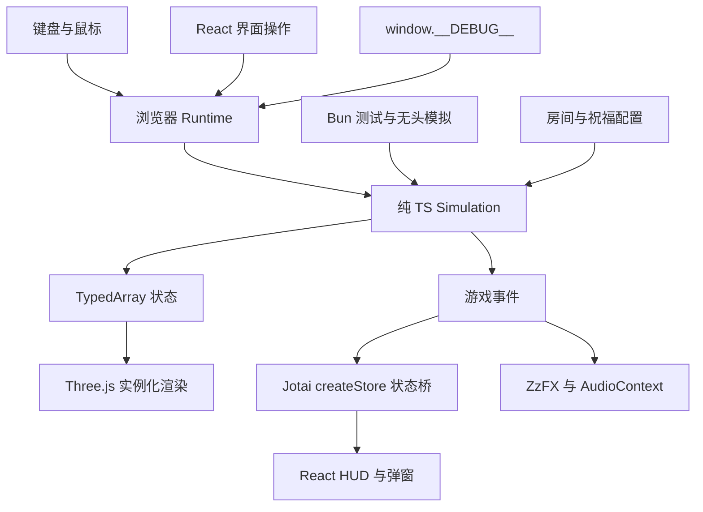

# 架构与开发范围

## 技术分工

| 层 | 技术与职责 | 实现位置 |
| --- | --- | --- |
| 工具链 | Bun 1.3.14 包管理、测试、无头模拟；Vite 开发和构建；TypeScript strict | package.json |
| 微内核 | 60Hz Simulation.tick()、种子随机数、SoA 对象池、二维网格、碰撞、动作与效果结算 | src/engine/ |
| 内容 | ASCII 字符串房间、祝福定义与 Hook | src/content/ |
| 表现 | Three.js、postprocessing、Billboard 实例化与 GLSL | src/view/renderer.ts |
| 音效 | ZzFX 生成缓存，AudioContext 播放、限流与动态压缩 | src/view/audio.ts |
| UI | React、Tailwind CSS、Jotai Vanilla Store | src/ui/ |
| 连接与调试 | 浏览器输入、时间累计、事件投递、开发调试入口 | src/runtime.ts、src/debug.ts |

微内核只实现这个游戏需要的行为。代码规模随真实功能增长，不按行数限制模块或省略测试。

## 高频与低频状态

位置、速度、生命、投射物寿命、受击闪白等核心字段存放在对象池中。渲染直接读取数组。每个池用连续活动槽位和空闲槽位管理实体，回收槽位后分配新的实体 ID。

`createUiBridge()` 创建一个 store，交给 React Provider 和 Runtime。Runtime 收到扣血、击杀、祝福、换房等事件后，按字段检查并更新 Atom。移动和渲染不写 Atom。暂停弹窗由浏览器操作维护，调试暂停可以保留完整战斗画面。

核心对局独立于 React、Jotai、Three.js 和 DOM。通过外部事件适配器连接 UI，使每个无头对局可以拥有独立状态。`computedStatsAtom` 与战斗共用 `calcPlayerStats()`，属性公式只维护一份。

## 时间、随机数与碰撞

基础 tick 固定为 1/60 秒。Runtime 用真实时间累计驱动 tick；调试和 Bun 直接调用相同入口。隐藏页面或失去焦点时暂停，恢复时清空真实时间累计，避免补跑后台停留时间。

`tickCount` 记录基础步数；`combatTick` 仅在实际战斗更新时增加。顿帧消耗基础 tick，冻结战斗更新。射击冷却、冲刺、无敌和投射物寿命采用战斗 tick。渲染动画读取战斗时间，截图时不会自行漂移。

`SeededRNG` 使用 Park–Miller 算法，当前控制敌人速度。固定种子、内容和输入用于重放；跨运行时一致性通过实际场景逐字段比较。视觉与音效不能消耗游戏随机状态。

二维网格使用有限房间的整数格坐标直接索引数组。敌人坐标建立空间索引，投射物查询附近实体。投射物按最多 0.1 单位的子步推进，墙体和圆形命中逐步检查；增加速度、改变体积或加入移动攻击时需要补充相应测试。角色使用分轴墙体碰撞，敌人使用房间距离场寻路。

容量不足时敌人创建给出明确错误；弹幕记录 `rejectedBullets`。应根据实际场景测量容量、帧时间、分配与内存。对象池不会自动保证整个程序零 GC。

## Hook 与房间

`onFire` 修改发射数量和伤害，`onSpawnBullet` 配置弹墙次数，`onHit` 处理吸血，`onDash` 修改冲刺持续时间。效果按内容定义顺序执行，每项祝福当前最多一层。新增行为直接加入内容模块并验证与已有祝福的组合。

房间配置使用 `#` 墙、`.` 地面、`P` 出生点、`E` 敌人。`check:data` 汇总行宽、高度、符号、出生点、地面可达性和祝福 ID 错误。当前两间战斗房顺序连接；清房后选取奖励进入下一间，最终房清空进入通关界面。

## 表现与后续内容

当前有 45° 俯视相机、原创四帧 Billboard、实例化地面和投射物、倾斜、轻微挤压、受击闪白、顿帧及 Bloom。片元着色器处理非有限颜色并限制输出范围；仍需检查 CPU 输入、材质编译和渲染目标，不能据此承诺所有黑屏都已预防。

后续按可用玩法接入：更多武器、近战前摇与攻击阶段、敌人分离、Boss、随机路线和道具联动；再按对应场景加入冲刺残影、树木 Bayer 遮挡透视、镜头反馈与慢动作。每项功能同时提供调试场景与行为测试。

较完整内容目标为 1 个角色、3 种武器、12 个祝福、8 个房间模板、4 类普通敌人及 1 个 Boss。单局 10～15 分钟是试玩目标；当前两房原型没有达到这个内容规模。
