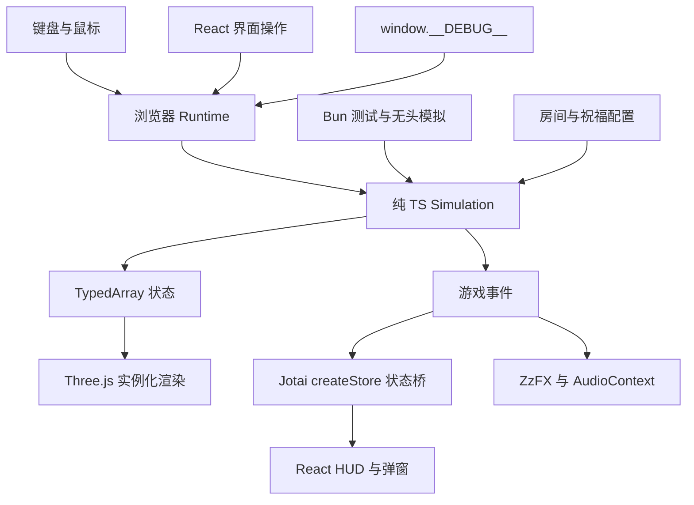

# 架构与开发范围

## 技术分工

| 层 | 技术与职责 | 实现位置 |
| --- | --- | --- |
| 工具链 | Bun 1.3.14 包管理、测试、无头模拟；Vite 开发和构建；TypeScript strict | package.json |
| 微内核 | 60Hz Simulation.tick()、种子随机数、SoA 对象池、二维网格、碰撞、动作与效果结算 | src/engine/ |
| 内容 | ASCII 字符串房间、祝福定义与 Hook | src/content/ |
| 表现 | Three.js、postprocessing、Billboard 实例化与 GLSL | src/view/renderer.ts |
| 音效 | ZzFX 生成缓存，AudioContext 播放、限流与动态压缩 | src/view/audio.ts |
| UI | React、Tailwind CSS、Jotai Vanilla Store | src/ui/ |
| 连接与调试 | 浏览器输入、时间累计、事件投递、开发调试入口 | src/runtime.ts、src/debug.ts |

微内核只实现这个游戏需要的行为。代码规模随真实功能增长，不按行数限制模块或省略测试。

## 高频与低频状态

位置、速度、生命、投射物寿命、受击闪白等核心字段存放在对象池中。渲染直接读取数组。每个池用连续活动槽位和空闲槽位管理实体，回收槽位后分配新的实体 ID。

`createUiBridge()` 创建一个 store，交给 React Provider 和 Runtime。Runtime 收到扣血、击杀、祝福、换房等事件后，按字段检查并更新 Atom。移动和渲染不写 Atom。暂停弹窗由浏览器操作维护，调试暂停可以保留完整战斗画面。

核心对局独立于 React、Jotai、Three.js 和 DOM。通过外部事件适配器连接 UI，使每个无头对局可以拥有独立状态。`computedStatsAtom` 与战斗共用 `calcPlayerStats()`，属性公式只维护一份。

## 时间、随机数与碰撞

基础 tick 固定为 1/60 秒。Runtime 用真实时间累计驱动 tick；调试和 Bun 直接调用相同入口。隐藏页面或失去焦点时暂停，恢复时清空真实时间累计，避免补跑后台停留时间。

`tickCount` 记录基础步数；`combatTick` 仅在实际战斗更新时增加。顿帧消耗基础 tick，冻结战斗更新。射击冷却、冲刺、无敌和投射物寿命采用战斗 tick。渲染动画读取战斗时间，截图时不会自行漂移。

`SeededRNG` 使用 Park–Miller 算法，当前控制敌人速度。固定种子、内容和输入用于重放；跨运行时一致性通过实际场景逐字段比较。视觉与音效不能消耗游戏随机状态。

二维网格使用有限房间的整数格坐标直接索引数组。敌人坐标建立空间索引，投射物查询附近实体。投射物按最多 0.1 单位的子步推进，墙体和圆形命中逐步检查；增加速度、改变体积或加入移动攻击时需要补充相应测试。角色使用分轴墙体碰撞，敌人使用房间距离场寻路。

容量不足时敌人创建给出明确错误；弹幕记录 `rejectedBullets`。应根据实际场景测量容量、帧时间、分配与内存。对象池不会自动保证整个程序零 GC。

## Hook 与房间

`onFire` 修改发射数量和伤害，`onSpawnBullet` 配置反弹次数与每次反弹倍率，`onDash` 配置轨迹和下一次攻击强化，`onKill` 处理近距离击杀奖励。效果按内容定义顺序执行，每项祝福最多一层。新增行为直接加入内容模块并验证与已有祝福的组合。

房间配置使用 `#` 墙、`.` 地面、`P` 出生点、`C` 冲锋兽、`T` 投弹怪、`G` 卫兵、`B` Boss。`check:data` 汇总行宽、高度、符号、出生点、地面可达性和祝福 ID 错误。六间房按顺序连接，共 46 个敌人；五间普通房有 2～3 波，末房为 Boss。清波后留出 1.5 秒调整位置，清房恢复 12 点生命并选奖励。奖励列表由同一函数提供给 UI、核心校验和 Bot；所有祝福已拥有时提供继续入口。

敌人动作直接使用接近、前摇、攻击、恢复、失衡、受处决六种状态。冲锋和挥击在前摇时锁定朝向；投弹在开始前摇时锁定落点；卫兵恢复和失衡阶段放下盾牌。Boss 按冲撞、落弹、扇形弹幕顺序出招，半血后恢复时间从 65 tick 缩短至 28 tick，弹速从 6 提高到 8。

普通弹伤害 18，攻击间隔 12 tick。蓄力需 12～60 tick，移动速度从 4.8 降至 2.5；松开后伤害为 18 × (1 + 4 × 蓄力比例)。蓄力弹记录已命中的实体 ID，最多贯穿 8 个不同目标，反弹后也不会重复命中同一目标。冲刺取消正在进行的蓄力，必须松开再按才能重新蓄力。

反弹最多两次，伤害倍率在反弹时结算。破晓仅消费一次攻击事件，可同时强化该次攻击的散射弹。烬行轨迹共享每个敌人 15 tick 的受伤间隔，重叠轨迹不会在同一 tick 重复伤害。轨迹、落弹和视觉事件是短生命周期数组，按战斗 tick 到期回收；当前不承诺整个战斗零分配。

## 类魂战斗：削韧与处决

第一阶段继续使用 X-Z 地面坐标和 45° 俯视表现。韧性、恢复计时和动作状态直接保存在现有 SoA 对象池；命中、击杀、祝福与奖励复用现有结算。规则由 Simulation 驱动，画面和音效读取结果。

| 对象 | 最大韧性 | 耗尽后的行为 |
| --- | --- | --- |
| 玩家 | 40 | 硬直 30 战斗帧，中断蓄力，结束后恢复韧性 |
| 冲锋兽、投弹怪 | 15 | 失衡 120 战斗帧 |
| 持盾卫兵 | 30 | 放下盾牌，失衡 120 战斗帧 |
| 苔冠守望者 | 120 | 中断出招，失衡 120 战斗帧 |

普通弹削韧 5；蓄力弹为 `5 + 25 × 蓄力比例`，满蓄力 30。卫兵正面格挡承受 50% 削韧并抵挡生命伤害。散射每发独立结算，贯穿对同一敌人只结算一次；反弹和破晓强化生命伤害，削韧保持原值。烬行只造成生命伤害。玩家受到实际命中时扣除等于该次伤害值的韧性，无敌期间两者都不扣。

连续 300 战斗帧未受削韧，韧性一次恢复到上限。再次命中重置计时。失衡时停止行动和接触伤害，后续普通命中可以伤害但不延长失衡窗口。窗口结束后恢复韧性，经过 30 帧恢复阶段再行动。破韧或击杀会取消该敌人尚未生效的落弹预告；已经生效的爆炸与已发射弹幕继续存在。

进入失衡目标 1.6 格内且视线无遮挡，重新按下左键触发处决，按住攻击不会自动触发。挥击、蓄力、冲刺和硬直期间不能开始处决。处决锁定当时最近目标的实体 ID，双方停止移动，玩家全程无敌，目标只接受本次处决伤害。48 战斗帧动作的第 24 帧造成基础灵弹伤害的 15 倍，当前为 270；每次只结算一次，击杀仍触发正常金币与祝福效果。Boss 存活则恢复韧性并进入恢复阶段。最后一个敌人被处决时，动作完成后再显示房间奖励。

三维表现读取上述状态：敌人头顶金色余韧条、跪地压缩动作、金色弱点、金属破韧音效、处决武器刺击、镜头推近与重击震屏。计时和镜头进度都取自战斗帧，暂停和步进能精确检查中间状态。Jotai 只更新玩家韧性与进入/离开处决范围的提示，不接收每帧坐标或倒计时。

## 大剑动作、精力与翻滚

大剑为初始武器，Q 可切换灵弹；切换需等挥击、蓄力、翻滚、硬直、处决和射击冷却结束。武器参数在 `src/content/weapons.ts`，动作推进与命中复用 Simulation；每次挥击保存一份动作状态及命中实体集合。

| 动作 | 前摇 / 生效 / 后摇（战斗帧） | 伤害 | 削韧 | 精力 | 攻击长度 |
| --- | --- | --- | --- | --- | --- |
| 横斩 | 8 / 6 / 12 | 60 | 12 | 14 | 2.1 |
| 回斩 | 9 / 6 / 14 | 70 | 15 | 16 | 2.2 |
| 终结斩 | 13 / 8 / 18 | 100 | 25 | 22 | 2.5 |
| 满蓄力重斩 | 12 / 10 / 24 | 150 | 40 | 28 | 2.6 |

左键持续按住按三段循环，间隔超过上一段完成后的 36 帧从横斩开始。重斩需蓄力 12～60 帧，伤害为 `90 + 60 × 蓄力比例`，削韧为 `18 + 22 × 蓄力比例`。动作开始锁定方向。`swingAngle()` 同时驱动剑身、刀光和每个生效帧扫过的命中角度；加上目标半径检测，并验证墙体视线。每个目标每次挥击最多受击一次。盾牌正面照常挡伤并承受一半削韧。

精力上限 100。挥击在开始时扣除，灵弹普通/蓄力攻击分别消耗 4/18，翻滚消耗 24。不足时不启动动作。挥击、蓄力、翻滚、硬直和处决期间停止恢复；动作结束后等待 45 帧，每 6 帧恢复 3。核心保存精确数值，Jotai 在消耗时立即更新、恢复时最多每秒更新 10 次。精力与韧性独立。

翻滚持续 18 战斗帧，速度 10，全程无敌，开始后 48 帧可再次翻滚。方向在开始时锁定，不能穿墙。它可以取消蓄力或挥击后摇最后 8 帧；挥击前摇和生效阶段需要完成。取消后不会残留剑刃伤害。玩家破韧与死亡中断当前挥击，换房清空动作并恢复精力。

## 基础美术规范

角色图集是 256×320 的 CanvasTexture：每格 64×64，四列动作帧，五行依次为骑士、冲锋兽、投弹怪、卫兵、Boss。骑士由暗色披风、银色头盔、发光眼睛和独立双脚组成，武器不画进身体图集。替换 PNG 时沿用相同尺寸、行顺序、透明背景和网格即可复用 UV 规则。

大剑由剑刃、护手和剑柄几何体组成，绕角色旋转；刀光为可复用顶点缓冲，读取当前生效帧的扫过角度。披风摆动使用顶点 Shader，翻滚使用团身缩放和旋转，受击使用闪白。场景继续使用实例化几何体，音效使用 ZzFX 数组。美术与声音不消耗游戏随机数，也不修改战斗计时。

HUD 显示红色生命条、绿色精力条、韧性数值、当前武器、Boss 血量及处决提示。法力、药瓶和战技的界面随对应玩法增加。外部资产引入时逐包核对许可；模型统一使用贴图内嵌的 GLB，图标可用 SVG，精灵使用 PNG，音频可用 OGG。

## Soulsvania 后续设计

长期方向是类银河城探索与类魂战斗结合，原创角色、地图和美术。当前六房路线可继续试玩；横版 XY 平台移动与俯视 X-Z 是不同地图规则，视角及跳跃需求在进入世界探索阶段时确定。

| 阶段 | 内容 | 验证方式 |
| --- | --- | --- |
| 动作扩展 | 弹反、战技及武器专属位移曲线 | 同一套 Simulation 步进检查每帧可用动作、消耗和无敌边界 |
| 碰撞扩展 | 实体间阻挡分离、不同招式的受击形状与高度 | 保持每次挥击单次命中，验证狭窄场景中角色不会重叠堵死 |
| Boss 招式 | 距离、冷却驱动的加权招式，快慢节奏、喝药反应及阶段变化 | 固定种子验证出招条件、预告与实际伤害时间 |
| 世界探索 | 房间图、钥匙/能力门、单向门、捷径及世界开关，房内继续使用 ASCII 模板 | 按已获得能力搜索可达路径，验证捷径和关键道具不会互相锁死 |
| 装备与存续 | 武器动作组与战技、护符组合、休息点、补给瓶、死亡掉落与回收资源 | 装备属性与真实伤害共用公式，验证休息重置和掉落回收规则 |
| 可视调试 | 攻击/受击/阻挡范围叠加、动作帧和无敌窗口可视化 | 复用 Tabbit 会话与 `step()`，截图与结构化状态互相核对 |

每个功能先在现有内容与核心模块中实现所需规则；出现真实复用需求时再提取共同函数。弹反、实体间阻挡、世界图和存档属于后续实现范围。

## 表现与后续内容

当前有 45° 俯视相机、五类原创四帧 Billboard、实例化地面和投射物、移动摆动、蓄力挤压和光圈、武器后坐力、受击闪白、击退、冲刺余影、消散、顿帧、轻微震屏及 Bloom。冲撞方向、卫兵挥击范围、Boss 扇形攻击和落弹位置由核心状态直接驱动。Boss 血量按命中事件更新 Jotai，蓄力光圈与冲刺恢复条直接由 Three.js 渲染。

片元着色器处理非有限颜色并限制输出范围；仍需检查 CPU 输入、材质编译和渲染目标，不能据此承诺所有黑屏都已预防。场景使用程序化美术，音效为 ZzFX 合成；精细动作素材、随机路线、更多武器、敌人分离及树木遮挡透视属于后续内容。

当前内容为 1 个角色、大剑与灵弹 2 种武器、6 个祝福、6 间流程房与 1 间训练场、3 类普通敌人及 1 个 Boss。5～8 分钟是人工试玩目标，尚未验证；Bot 的模拟通关时间不能代表人的学习与选择时间。
