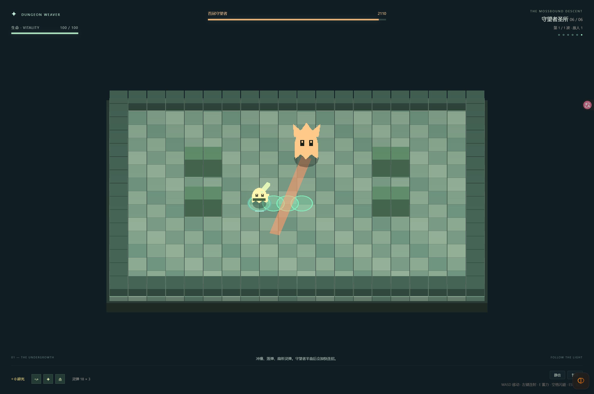

# 实际验证记录

2026-10-28，在 Bun 1.3.14、WSL 与 Windows Tabbit 环境中运行。

| 检查 | 结果 |
| --- | --- |
| Bun 规则测试 | 19 项通过、78 项断言；覆盖蓄力贯穿、取消蓄力、反弹倍率、冲刺祝福、敌人前摇、护盾、投弹、无敌、死亡、完整路线、对象池与 HUD。 |
| 内容检查 | 7 个房间（含训练场）、6 个祝福、4 种敌人（含 Boss），检查通过。 |
| TypeScript 与生产构建 | strict 类型检查和 Vite 构建通过。 |
| Bun 完整对局 | 种子 42，6940 个基础 tick、6553 个战斗 tick，击败 46 个敌人，通关六房，剩余生命 57。 |
| 浏览器与 Bun 一致性 | 180 tick 训练场景，以及完整六房 Bot 对局，最终结构化状态逐字段一致。 |
| 精确步进 | 180 tick 与两次 90 tick 相等；暂停后等待浏览器动画帧，游戏状态保持不变。 |
| 真实 UI 和输入 | Tabbit 点击奖励进入余烬密室；键盘移动、空格冲刺、鼠标连射、E 键蓄力与松开发射均通过。 |
| 生产浏览器预览 | 可以进入游戏，开发调试入口不存在，页面及着色器错误列表为空。 |
| 视觉检查 | 已查看普通混合遭遇与 Boss 场景截图，角色轮廓、蓄力光圈、冲撞预告、投弹区域、冲刺轨迹和 HUD 可见。 |

完整 Bot 对局约对应 116 秒基础模拟时间，包含固定顿帧，奖励自动选择。Bot 使用正式移动、射击、闪避及奖励接口；不修改生命、不移除敌人、不跳房。这个结果验证路线可完成，不能代表人的学习与选择时间。5～8 分钟的人工试玩目标尚未验证。

本机 Tabbit 的右键操作没有向页面传递按下事件，只收到了释放与菜单事件。游戏同时提供 E 键蓄力，已实际验证。未声称完成右键长按的浏览器验收。

对象池有 2000 敌人、5000 弹幕槽位；该容量下的帧时间、GC、峰值内存尚未测试。当前美术为程序化图集，音效已接入播放与压缩链路，精细动作和实际听感仍需人工试玩评估。随机路线与树木遮挡透视属于后续内容。

构建器报告了 Jotai 客户端指令提示和主包体积提示，构建成功；主脚本约 872 kB，gzip 约 235 kB。当前是单页浏览器应用，加载时间需按目标设备和网络继续测量。

截图使用调试接口构造实际战斗状态，并复用同一个 Tabbit 游戏标签页。

