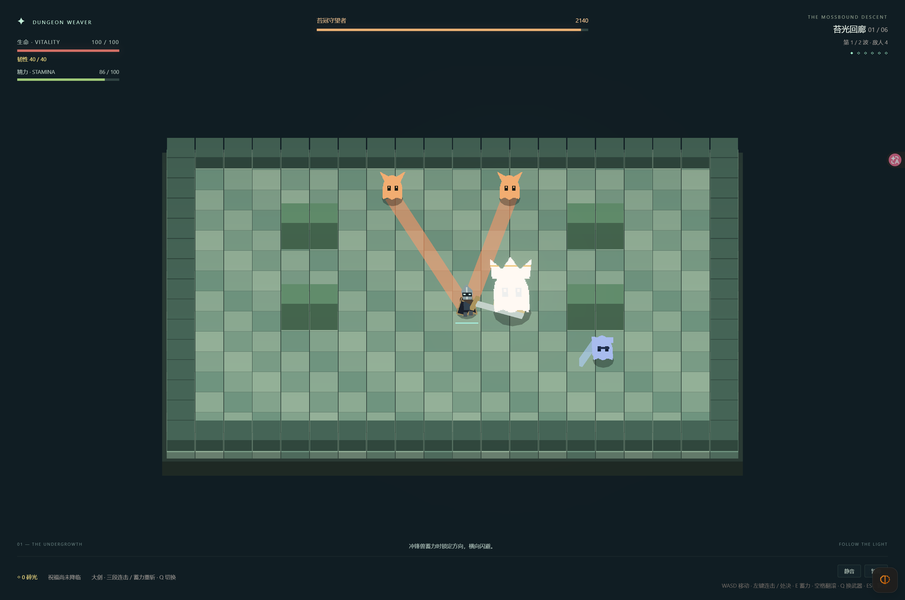

# 实际验证记录

2026-10-28，在 Bun 1.3.14、WSL 与 Windows Tabbit 环境中运行。

| 检查 | 结果 |
| --- | --- |
| Bun 规则测试 | 37 项通过、209 项断言；覆盖大剑连段、单次命中、墙体遮挡、蓄力重斩、精力、翻滚取消、削韧处决、祝福和完整路线。 |
| 内容检查 | 7 个房间（含训练场）、6 个祝福、4 种敌人（含 Boss），检查通过。 |
| TypeScript 与生产构建 | strict 类型检查和 Vite 构建通过。 |
| Bun 完整对局 | 种子 42，16920 个基础 tick、16553 个战斗 tick，击败 46 个敌人，通关六房，剩余生命 96，累计承伤 78。 |
| 浏览器与 Bun 一致性 | 180 tick 训练场景，以及完整六房 Bot 对局，最终结构化状态逐字段一致。 |
| 精确步进 | 180 tick 与两次 90 tick 相等；暂停后等待浏览器动画帧，游戏状态保持不变。 |
| 真实 UI 和输入 | Tabbit 点击奖励进入余烬密室；键盘移动、空格翻滚、鼠标射击、E 键蓄力通过；真实鼠标触发处决并完成奖励结算。大剑三段攻击后精力为 48，满蓄力重斩伤害 150；精力 HUD 与 Q 键换武器通过。 |
| 近战边界 | Boss 实际承受三段共 230 伤害、52 削韧；满蓄力重斩为 150/40；盾牌正面挡伤并承受一半削韧。前摇不命中，同一挥击不重复命中，墙体遮挡有效。 |
| 翻滚边界 | 消耗 24 精力；真实落弹爆炸中连续 18 战斗帧无敌，下一帧正常受伤。前摇不能取消，后摇末段可翻滚取消。 |
| 处决边界 | 第 24 战斗帧命中、第 48 帧完成；测试中落弹在整个动作内不扣血，结束后的下一帧正常扣血；Boss 实际受到 270 点处决伤害并恢复韧性。 |
| 生产浏览器预览 | 可以进入游戏，鼠标挥剑消耗精力，Q 切换灵弹；开发调试入口不存在，页面及着色器错误列表为空。 |
| 视觉检查 | 已查看实际战斗截图：披风骑士、独立大剑、命中闪白与精力 HUD 可见；精力条宽度与数值 86/100 一致。 |

完整 Bot 对局对应 282 秒基础模拟时间，包含固定顿帧，奖励自动选择。Bot 按距离切换大剑与灵弹，使用正式移动、攻击、翻滚、处决及奖励接口；不修改生命、不移除敌人、不跳房。这个结果验证两种武器配合下路线可完成，不能代表人的学习与选择时间。5～8 分钟的人工试玩目标尚未验证。

本机 Tabbit 的右键操作没有向页面传递按下事件，只收到了释放与菜单事件。游戏同时提供 E 键蓄力，已实际验证。右键长按的浏览器验收尚未完成。

对象池有 2000 敌人、5000 弹幕槽位；该容量下的帧时间、GC、峰值内存尚未测试。当前美术为程序化图集和几何体，音效已接入播放与压缩链路，动作手感和实际听感仍需人工试玩评估。

构建器报告了 Jotai 客户端指令提示和主包体积提示，构建成功；主脚本约 885 kB，gzip 约 239 kB。当前是单页浏览器应用，加载时间需按目标设备和网络继续测量。

截图使用调试接口构造实际战斗状态，并复用同一个 Tabbit 游戏标签页。

